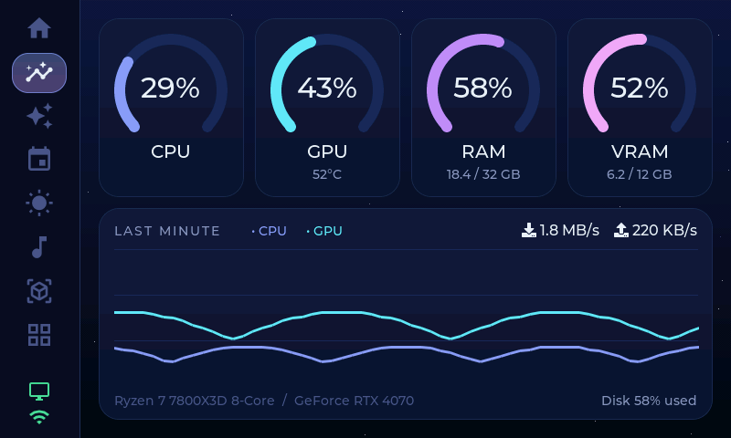
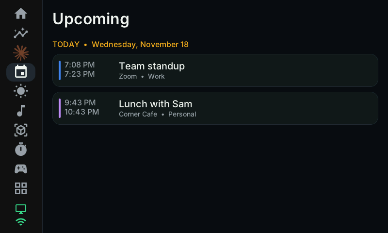
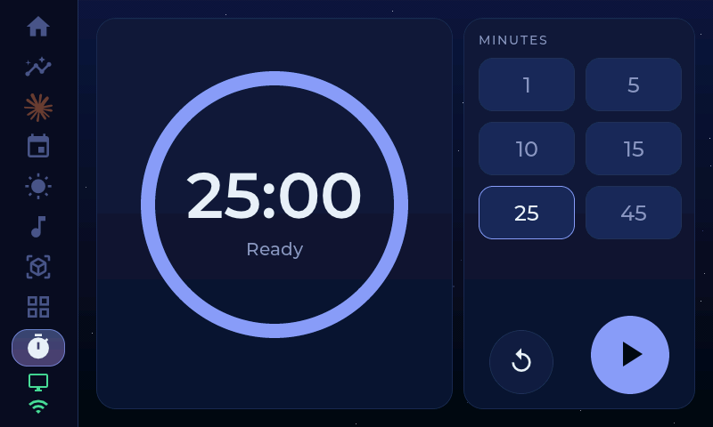
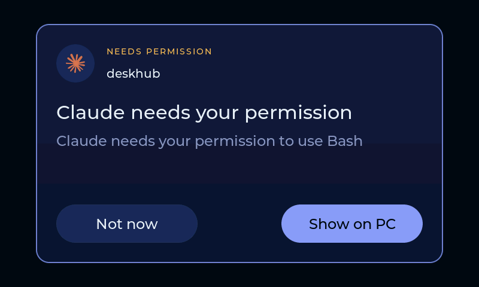
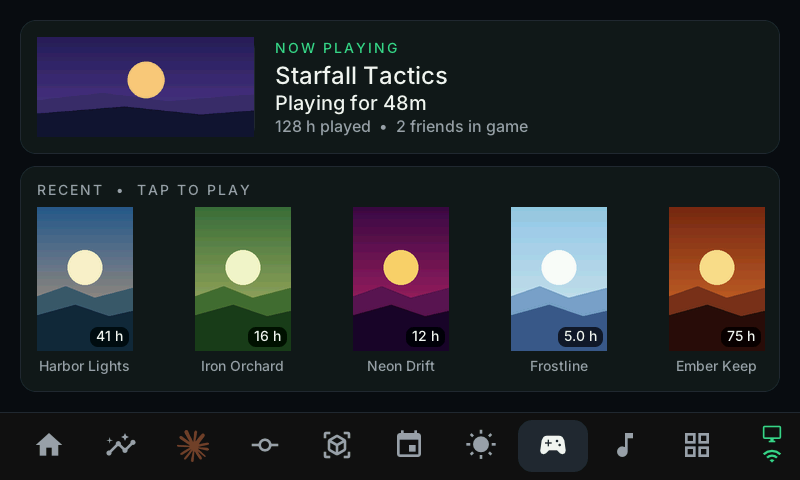
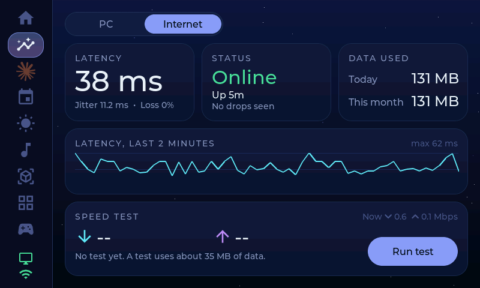

# Desk Hub

A desk display for the **Waveshare ESP32-S3-Touch-LCD-4.3B**. It shows the time, weather, your calendar, what's playing on your PC, CPU and GPU load, and your Claude Code usage. It also gives you a grid of buttons that run things on your PC.


The board runs custom firmware (ESP-IDF + LVGL). A small Python app on your Windows PC, the *companion*, sends it PC data over your Wi-Fi. The clock and weather keep working when the PC is off.

| | |
| --- | --- |
|  |  |
|  |  |
|  |  |
|  |  |
|  |  |

## Features

| Page | What it shows | Where the data comes from |
| --- | --- | --- |
| Home | Clock, date, Claude limits, next events, weather, now playing, CPU/GPU/RAM | everything below |
| PC stats | CPU, GPU, RAM and VRAM gauges, GPU temperature, a one-minute history chart, network and disk | companion |
| AI | Claude Code or Codex 5-hour and weekly limits with reset times, tokens today, a 7-day chart, usage per model | companion, from Claude Code or Codex |
| Calendar | Up to 16 upcoming events in the next 7 days, grouped by day | companion, from Google, Apple iCloud, Outlook or any ICS feed |
| Weather | Current conditions, the next 24 hours and 6 days | the board itself, from [Open-Meteo](https://open-meteo.com) |
| Media | Whatever Windows lists as playing (Spotify, YouTube in a browser, VLC…) with the cover, a seek bar and controls | companion |
| Shortcuts | Up to 16 buttons: key combos, apps, folders, URLs, volume, media, lock PC | companion |
| 3D printer | Bambu Lab print state, progress, temperatures and AMS colours for up to 4 printers (optional) | companion, over MQTT |
| Games | The Steam game you're playing with its cover and session time, your five most recent games, and a tap to launch one (optional) | companion, from Steam's local files |
| Stats: Internet view | Online status, latency, jitter and packet loss with a one-minute chart, uptime and the last drop, data used today and this month, and an on-demand speed test | companion |
| Timer | Countdown with presets from 1 to 45 minutes, pause and reset, and a full-screen "Time's up" card. The time left shows on its sidebar tab | the board itself, works without the PC |

## What you need

- A [Waveshare ESP32-S3-Touch-LCD-4.3B](https://www.waveshare.com/esp32-s3-touch-lcd-4.3b.htm). This is the **B** model (800 × 480, capacitive touch). Other boards have different wiring and won't work without changes.
- A USB-C **data** cable. Some cables only carry power.
- A Windows 10/11 PC on the same network. NVIDIA GPU stats need an NVIDIA driver; everything else works on any PC.
- A **2.4 GHz** Wi-Fi network. The ESP32-S3 can't join 5 GHz networks.

## Setup

### 1. Install the tools

1. **Git**: [git-scm.com](https://git-scm.com/download/win).
2. **uv**, which runs the companion and installs its Python: [docs.astral.sh/uv](https://docs.astral.sh/uv/getting-started/installation/). In PowerShell:

   ```powershell
   powershell -ExecutionPolicy ByPass -c "irm https://astral.sh/uv/install.ps1 | iex"
   ```

3. **ESP-IDF v5.5**, Espressif's toolchain for building the firmware. The easiest route is the [ESP-IDF Windows installer](https://dl.espressif.com/dl/esp-idf/). Choose version **5.5**, target **ESP32-S3**, and keep the default install folder. Setup looks for ESP-IDF in `C:\Espressif\frameworks\esp-idf-*`, `C:\esp\v5.5\esp-idf`, `%USERPROFILE%\esp\esp-idf-*`, and the folder named by the `IDF_PATH` environment variable.

In this README, `~` means your user folder, `C:\Users\<you>`.

### 2. Get the code

```powershell
git clone https://github.com/<owner>/deskhub.git
cd deskhub\companion
```

Replace `<owner>` with the GitHub account that hosts this repo. Clone to a short path such as `C:\Code\deskhub`. Very long Windows paths break some of the Python packages.

### 3. Run setup

Plug the board into your PC with the USB-C cable. If your board has two USB-C ports, use the one labeled **USB**, not **UART**. Then run:

```powershell
uv run deskhub-setup
```

It asks these questions in order. When you run it again, each answer you gave before shows in brackets, and Enter keeps it. On the first run the answers start blank.

1. **Wi-Fi**: the network name, then the password. The password stays hidden as you type, and pressing Enter keeps the saved one. The hub needs a WPA password of 8 to 63 characters, so open networks aren't supported.
2. **City**: type something like `Charlotte, NC` or `Paris, France` and pick from the matches. This sets the weather location and the time zone.
3. **Units**: two yes/no questions. The first asks "Fahrenheit and mph", which defaults to yes for US cities. The second asks "24-hour clock".
4. **Calendars**: setup asks whether you want to add Google or Apple calendars now. See [Calendars](#calendars).
5. **3D printers**: whether to add or change Bambu Lab printers. See [3D printer](#3d-printer-bambu-lab).
6. **Games**: whether to add games that aren't on Steam, such as Minecraft. See [Games that aren't on Steam](#games-that-arent-on-steam).
7. **Pages**: a yes/no for each page, to choose which ones the sidebar shows (Home is always shown), then where the navigation bar goes: `left`, `right` or `bottom`. Moving it restarts the board once so every page is laid out for the new space; with the bar along the bottom, pages use a slightly more compact layout.
8. **Home screen**: whether the time and date go in a slim top bar, then which widgets go in each column.
9. **Screen sleep and night mode**: whether the board goes dark (`off`), shows a dim clock (`clock`) or stays as it is (`none`) while the PC's screen sleeps, then night-mode hours such as `23:00-07:00` (or `off`) and what it shows at night. See [When the PC sleeps](#when-the-pc-sleeps).
10. **Claude Code limits**: whether to turn on live limits. See [Claude Code usage](#claude-code-usage).
11. **Waiting alerts**: whether the board shows when a Claude Code session is waiting for you. Setup offers to add the hooks to Claude Code's settings, update hooks from an older version, or remove them when you turn alerts off. See [Waiting alerts](#waiting-alerts).
12. **AI agent**: which agent the AI page shows: `auto`, `claude` or `codex`.
13. **Build and flash**: setup asks before it builds. Then it finds the board's USB port, or asks for the COM port if it can't tell (Device Manager lists it under *Ports*), and installs the firmware. The first build takes a few minutes.
14. **Start with Windows**: whether the companion starts by itself, hidden, when you sign in. See [Start the companion with Windows](#start-the-companion-with-windows).

Setup also creates `companion/config.toml` and gives the board and the companion a shared random token, so they can trust each other.

If setup says it can't find ESP-IDF, or the flash fails, you can flash by hand. Open PowerShell in the repo's `firmware\` folder and run these two lines, changing the path to match your ESP-IDF version and the port to match your board:

```powershell
. C:\Espressif\frameworks\esp-idf-v5.5.1\export.ps1
idf.py -p COM5 flash
```

### 4. Start the companion

```powershell
uv run python -m deskhub
```

Within a few seconds the monitor icon near the bottom of the board's sidebar, just above the Wi-Fi icon, turns green. The stats, media and calendar pages then fill in. Leave this window open while you use the board, and run other commands such as `uv run deskhub-calendars` in a second terminal.

Start it with `python -m deskhub` as shown, not `uv run deskhub`. The `deskhub.exe` launcher stays locked while the companion runs, so any later `uv run` that needs to update the project fails with "Access is denied".

To change anything later, run `uv run deskhub-setup` again.

### Start the companion with Windows

```bash
uv run deskhub-install
```

This puts a shortcut in your Startup folder that runs the companion hidden (with `pythonw`, so no terminal window) each time you sign in. Setup offers it as its last step. Without a console, the companion logs to `~/.deskhub/companion.log`. To undo it:

```bash
uv run deskhub-install --remove
```

The hidden companion shows an icon in the notification area by the clock: amber while the board is connected, grey while it isn't, with the board's name and IP in its tooltip. Right-click it for **Edit config**, **Run setup**, **Restart** (picks up config changes), **Open log** and **Quit**; double-click opens the config. Run `uv run deskhub --tray` to get the icon from a terminal too.

Only one companion runs at a time: if the hidden one is already running, starting another in a terminal stops with a message, because two would keep knocking each other off the board.

## Calendars

Setup offers this step. You can also run it on its own:

```powershell
uv run deskhub-calendars
```

That opens a menu to list, add and remove calendars. Restart the companion afterwards.

- **Google Calendar**: on [calendar.google.com](https://calendar.google.com), open Settings, pick your calendar, go to *Integrate calendar*, and copy the **Secret address in iCal format**. Choose *Add Google Calendar* and paste it. The helper fetches it once to check that it works.
- **Apple iCloud**: create an app-specific password at [account.apple.com](https://account.apple.com) under *Sign-In and Security → App-Specific Passwords*. Choose *Add Apple (iCloud) calendar*, then enter your Apple ID and that password and pick the calendars to show. Private calendars work, so you don't need to make anything public. The password goes into Windows Credential Manager, not into `config.toml`.
  Only calendars stored **in iCloud** come through. Calendars listed under *On My iPhone* exist only on the phone, so nothing else can read them. Turn on iCloud for Calendars (*Settings → your name → iCloud → Calendars*) and merge when asked, or move the events into an iCloud calendar.
- **Subscribed calendars, or any calendar link**: choose *Add a calendar link*. For an iPhone subscription, find the link under *Settings → Apps → Calendar → Calendar Accounts → Subscribed Calendars*; tap the calendar and copy its **Server** address.
- **Outlook / Microsoft 365, or any other ICS link**: use *Add a calendar link*, or add an entry like this to `config.toml`. Outlook's link is under *Settings → Calendar → Shared calendars → Publish a calendar*. A path to a local `.ics` file works in place of the URL.

  ```toml
  [[calendar.feeds]]
  name = "Work"          # optional
  url = "https://outlook.office365.com/owa/calendar/.../calendar.ics"
  color = "#f5a524"      # optional
  ```

The companion checks for new events every 10 minutes.

When Home doesn't show the *Up next* widget, a small dot on the sidebar's Calendar tab tells you there's still an event today. It takes the colour of that event's calendar (the first one the Calendar page lists) and goes away once the day's last event ends.

## Choosing pages

Home is always shown. To hide other pages, list the ones you want in `companion/config.toml`:

```toml
[pages]
enabled = ["home", "stats", "ai", "calendar", "weather", "media", "printer", "shortcuts", "timer", "games", "network"]
```

Remove a name to hide that page. Without a `[pages]` block everything is shown except the 3D printer page, which turns on by itself once you add a printer, and the Games page, which turns on when Steam is installed. Setup asks about each page too (the *Pages* step). The companion sends the list to the board every time it connects, so restart the companion after editing.

## When the PC sleeps

When Windows turns your monitor off, or the PC goes to sleep, the board follows it. Choose what it does in `companion/config.toml`:

```toml
[display]
pc_sleep = "off"   # "off" (default), "clock" or "none"
```

- `off`: the board's screen goes dark.
- `clock`: a dim clock with the date on black, moving to a new spot each minute.
- `none`: the board stays as it is.

Touch the board to bring it back for a minute; tap the clock to hide it. The board comes back by itself when the PC's screen wakes. Setup asks too (the *Screen sleep and night mode* step). Restart the companion after editing.

### Night mode

The board can also go dark on a schedule, whether the PC is on or not:

```toml
[display]
night = "23:00-07:00"   # leave empty for no night mode; "11pm-7am" works too
night_style = "clock"   # "off" (screen dark, default) or "clock"
```

The board keeps the schedule itself, so it still goes dark with the PC off. As with the PC sleeping, a touch brings it back for a minute. Setup asks for both (the *Screen sleep and night mode* step).