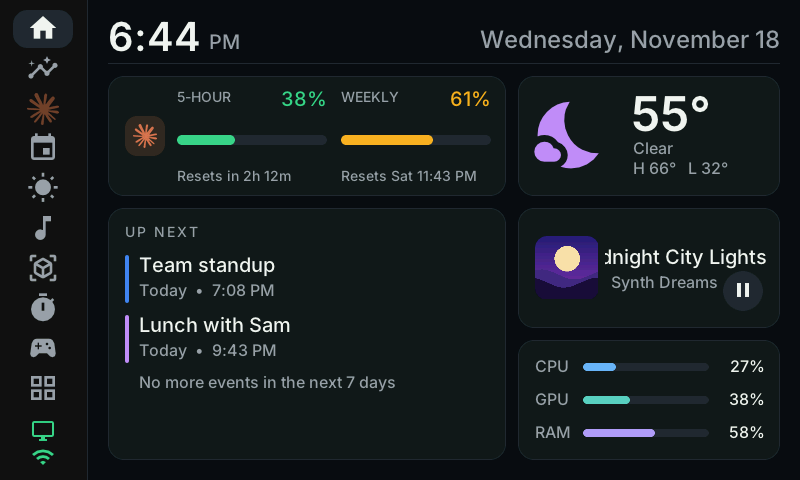
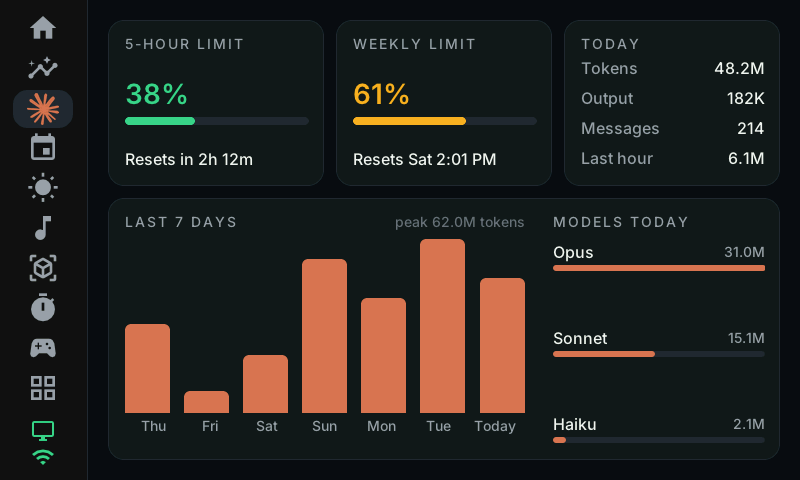
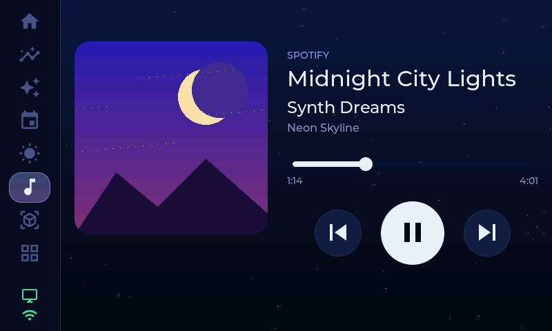
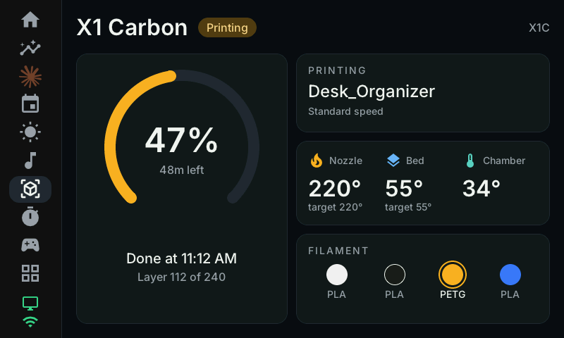
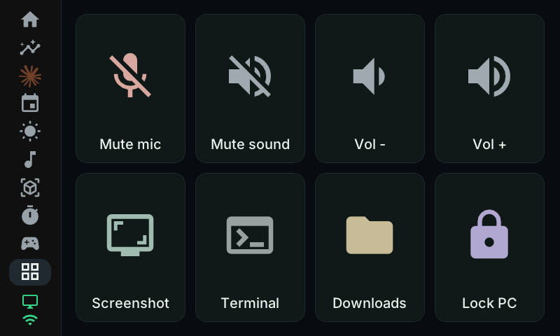

# Desk Hub

A desk display for the **Waveshare ESP32-S3-Touch-LCD-4.3B**. It shows the time, weather, your calendar, what's playing on your PC, CPU and GPU load, and your Claude Code usage. It also gives you a grid of buttons that run things on your PC.



The board runs custom firmware (ESP-IDF + LVGL). A small Python app on your Windows PC, the *companion*, sends it PC data over your Wi-Fi. The clock and weather keep working when the PC is off.

| | |
| --- | --- |
|  |  |
|  |  |
|  |  |
|  |  |
|  | |

## Features

| Page | What it shows | Where the data comes from |
| --- | --- | --- |
| Home | Clock, date, Claude limits, next events, weather, now playing, CPU/GPU/RAM | everything below |
| PC stats | CPU, GPU, RAM and VRAM gauges, GPU temperature, a one-minute history chart, network and disk | companion |
| AI | Claude Code or Codex 5-hour and weekly limits with reset times, tokens today, a 7-day chart, usage per model | companion, from Claude Code or Codex |
| Calendar | Up to 16 upcoming events in the next 7 days, grouped by day | companion, from Google, Apple iCloud, Outlook or any ICS feed |
| Weather | Current conditions, the next 24 hours and 6 days | the board itself, from [Open-Meteo](https://open-meteo.com) |
| Media | Whatever Windows lists as playing (Spotify, YouTube in a browser, VLC…) with the cover, a seek bar and controls | companion |
| Shortcuts | Up to 16 buttons: key combos, apps, folders, URLs, volume, media, lock PC | companion |
| 3D printer | Bambu Lab print state, progress, temperatures and AMS colours for up to 4 printers (optional) | companion, over MQTT |
| Games | The Steam game you're playing with its cover and session time, your five most recent games, and a tap to launch one (optional) | companion, from Steam's local files |
| Timer | Countdown with presets from 1 to 45 minutes, pause and reset, and a full-screen "Time's up" card. The time left shows on its sidebar tab | the board itself, works without the PC |

## What you need

- A [Waveshare ESP32-S3-Touch-LCD-4.3B](https://www.waveshare.com/esp32-s3-touch-lcd-4.3b.htm). This is the **B** model (800 × 480, capacitive touch). Other boards have different wiring and won't work without changes.
- A USB-C **data** cable. Some cables only carry power.
- A Windows 10/11 PC on the same network. NVIDIA GPU stats need an NVIDIA driver; everything else works on any PC.
- A **2.4 GHz** Wi-Fi network. The ESP32-S3 can't join 5 GHz networks.

## Setup

### 1. Install the tools

1. **Git**: [git-scm.com](https://git-scm.com/download/win).
2. **uv**, which runs the companion and installs its Python: [docs.astral.sh/uv](https://docs.astral.sh/uv/getting-started/installation/). In PowerShell:

   ```powershell
   powershell -ExecutionPolicy ByPass -c "irm https://astral.sh/uv/install.ps1 | iex"
   ```

3. **ESP-IDF v5.5**, Espressif's toolchain for building the firmware. The easiest route is the [ESP-IDF Windows installer](https://dl.espressif.com/dl/esp-idf/). Choose version **5.5**, target **ESP32-S3**, and keep the default install folder. Setup looks for ESP-IDF in `C:\Espressif\frameworks\esp-idf-*`, `C:\esp\v5.5\esp-idf`, `%USERPROFILE%\esp\esp-idf-*`, and the folder named by the `IDF_PATH` environment variable.

In this README, `~` means your user folder, `C:\Users\<you>`.

### 2. Get the code

```powershell
git clone https://github.com/<owner>/deskhub.git
cd deskhub\companion
```

Replace `<owner>` with the GitHub account that hosts this repo. Clone to a short path such as `C:\Code\deskhub`. Very long Windows paths break some of the Python packages.

### 3. Run setup

Plug the board into your PC with the USB-C cable. If your board has two USB-C ports, use the one labeled **USB**, not **UART**. Then run:

```powershell
uv run deskhub-setup
```

It asks these questions in order. When you run it again, each answer you gave before shows in brackets, and Enter keeps it. On the first run the answers start blank.

1. **Wi-Fi**: the network name, then the password. The password stays hidden as you type, and pressing Enter keeps the saved one. The hub needs a WPA password of 8 to 63 characters, so open networks aren't supported.
2. **City**: type something like `Charlotte, NC` or `Paris, France` and pick from the matches. This sets the weather location and the time zone.
3. **Units**: two yes/no questions. The first asks "Fahrenheit and mph", which defaults to yes for US cities. The second asks "24-hour clock".
4. **Calendars**: setup asks whether you want to add Google or Apple calendars now. See [Calendars](#calendars).
5. **3D printers**: whether to add or change Bambu Lab printers. See [3D printer](#3d-printer-bambu-lab).
6. **Pages**: a yes/no for each page, to choose which ones the sidebar shows. Home is always shown.
7. **Home screen**: whether the time and date go in a slim top bar, then which widgets go in each column.
8. **Claude Code limits**: whether to turn on live limits. See [Claude Code usage](#claude-code-usage).
9. **Waiting alerts**: whether the board shows when a Claude Code session is waiting for you. Setup offers to add the hooks to Claude Code's settings, update hooks from an older version, or remove them when you turn alerts off. See [Waiting alerts](#waiting-alerts).
10. **AI agent**: which agent the AI page shows: `auto`, `claude` or `codex`.
11. **Build and flash**: setup asks before it builds. Then it finds the board's USB port, or asks for the COM port if it can't tell (Device Manager lists it under *Ports*), and installs the firmware. The first build takes a few minutes.

Setup also creates `companion/config.toml` and gives the board and the companion a shared random token, so they can trust each other.

If setup says it can't find ESP-IDF, or the flash fails, you can flash by hand. Open PowerShell in the repo's `firmware\` folder and run these two lines, changing the path to match your ESP-IDF version and the port to match your board:

```powershell
. C:\Espressif\frameworks\esp-idf-v5.5.1\export.ps1
idf.py -p COM5 flash
```

### 4. Start the companion

```powershell
uv run python -m deskhub
```

Within a few seconds the monitor icon near the bottom of the board's sidebar, just above the Wi-Fi icon, turns green. The stats, media and calendar pages then fill in. Leave this window open while you use the board, and run other commands such as `uv run deskhub-calendars` in a second terminal.

Start it with `python -m deskhub` as shown, not `uv run deskhub`. The `deskhub.exe` launcher stays locked while the companion runs, so any later `uv run` that needs to update the project fails with "Access is denied".

To change anything later, run `uv run deskhub-setup` again.

### Start the companion with Windows

Press `Win+R`, type `shell:startup` and press Enter. In the folder that opens, create a shortcut with this target, changing the paths to where you cloned the repo:

```
C:\path\to\deskhub\companion\.venv\Scripts\pythonw.exe -m deskhub --config C:\path\to\deskhub\companion\config.toml
```

Set the shortcut's **Start in** field to the `companion` folder. `pythonw` runs it without a console window.

## Calendars

Setup offers this step. You can also run it on its own:

```powershell
uv run deskhub-calendars
```

That opens a menu to list, add and remove calendars. Restart the companion afterwards.

- **Google Calendar**: on [calendar.google.com](https://calendar.google.com), open Settings, pick your calendar, go to *Integrate calendar*, and copy the **Secret address in iCal format**. Choose *Add Google Calendar* and paste it. The helper fetches it once to check that it works.
- **Apple iCloud**: create an app-specific password at [account.apple.com](https://account.apple.com) under *Sign-In and Security → App-Specific Passwords*. Choose *Add Apple (iCloud) calendar*, then enter your Apple ID and that password and pick the calendars to show. Private calendars work, so you don't need to make anything public. The password goes into Windows Credential Manager, not into `config.toml`.
  Only calendars stored **in iCloud** come through. Calendars listed under *On My iPhone* exist only on the phone, so nothing else can read them. Turn on iCloud for Calendars (*Settings → your name → iCloud → Calendars*) and merge when asked, or move the events into an iCloud calendar.
- **Subscribed calendars, or any calendar link**: choose *Add a calendar link*. For an iPhone subscription, find the link under *Settings → Apps → Calendar → Calendar Accounts → Subscribed Calendars*; tap the calendar and copy its **Server** address.
- **Outlook / Microsoft 365, or any other ICS link**: use *Add a calendar link*, or add an entry like this to `config.toml`. Outlook's link is under *Settings → Calendar → Shared calendars → Publish a calendar*. A path to a local `.ics` file works in place of the URL.

  ```toml
  [[calendar.feeds]]
  name = "Work"          # optional
  url = "https://outlook.office365.com/owa/calendar/.../calendar.ics"
  color = "#f5a524"      # optional
  ```

The companion checks for new events every 10 minutes.

## Choosing pages

Home is always shown. To hide other pages, list the ones you want in `companion/config.toml`:

```toml
[pages]
enabled = ["home", "stats", "ai", "calendar", "weather", "media", "printer", "shortcuts", "timer", "games"]
```

Remove a name to hide that page. Without a `[pages]` block everything is shown except the 3D printer page, which turns on by itself once you add a printer, and the Games page, which turns on when Steam is installed. Setup asks about each page too (the *Pages* step). The companion sends the list to the board every time it connects, so restart the companion after editing.

## Steam

The Games page shows the game you're playing, with its cover and how long this session has run, and your five most recent games. Tap a recent game to launch it. The Home widget `game` shows the same game in a small card.

Everything comes from Steam's local files on your PC: the registry (which game is running), the library manifests and your `localconfig.vdf` (recent games and playtime). Cover art comes from Steam's public image CDN, and the names of recent games you've uninstalled from the public Store API. Only the game's appid is sent, and both are cached in `~/.deskhub`. Launching opens `steam://rungameid/<appid>`, and only for games in the recent list. Steam only keeps total playtime in that file for some games, so the total shows when it's there and is left out otherwise. To turn this off, set `enabled = false` under `[steam]` in `config.toml`.

## Customizing Home

Home has the time and date in a slim bar across the top, and widgets in two columns below it. List the widgets top to bottom in `companion/config.toml`, or use setup's *Home screen* step:

```toml
[home]
left = ["claude", "events"]
right = ["weather", "media", "stats"]
```

| Widget | Shows | Height |
| --- | --- | --- |
| `claude` | Claude Code 5-hour and weekly limits | 88 px |
| `events` | your next calendar events | fills what's left |
| `weather` | current conditions and today's high and low | 120 px |
| `media` | now playing, with a play/pause button | 120 px |
| `stats` | CPU, GPU and RAM bars | 120 px |
| `printer` | 3D print progress, time left and status | 120 px |
| `game` | the Steam game you're playing (or your latest one), with its cover | 120 px |
| `clock` | the big clock and date, for use without the top bar (see below) | about 124 px |

How the columns behave:

- **Size:** below the top bar each column is 384 px tall, which fits three 120 px widgets. The left column is wider.
- **`events`** stretches to fill its column, showing 1 to 3 events depending on the space.
- **Overflow:** widgets that don't fit at the bottom of a column are left out.
- **Hidden pages:** a widget whose page you've turned off in `[pages]` is skipped, and the widgets below it move up.
- **Tapping a widget** opens its page.

Without a `[home]` block you get the layout above. If you've added a printer, `printer` replaces `stats` on the right. The board remembers the layout, so it looks right at boot even before the companion connects.

**The big clock instead of the top bar.** The top bar shows the time with AM/PM on the left and the full date on the right, in about 44 px. For a large clock instead, turn the bar off and place the `clock` widget in a column:

```toml
[home]
header = false
left = ["clock", "claude", "events"]
right = ["weather", "media", "stats"]
```

The widget fills its column's width: in the narrow right column the digits scale to fit and AM/PM moves onto the date line. Without the top bar each column is the full 440 px tall. Setup's *Home screen* step asks which you want.

## 3D printer (Bambu Lab)

The printer page shows state, progress, time left, layer, temperatures, speed mode, errors and the AMS filament colours for up to 4 printers. It works with the A1, A1 mini, P1P, P1S, X1C, X1E and H2D. OrcaSlicer and Bambu Handy have no API of their own; they read the printer over MQTT, and so does the companion.

Setup offers a *3D printers* step. You can also run it on its own, then restart the companion:

```powershell
uv run deskhub-printers
```

Pick one way to connect per printer:

- **Cloud**: choose *Add printers from a Bambu cloud account*, enter your Bambu email and password, and the emailed verification code if Bambu asks for one, then pick your printers. This works from anywhere, and OrcaSlicer and Bambu Handy keep working normally. Your password is not stored. Bambu's access token (valid about 3 months) goes into Windows Credential Manager under `deskhub-bambu`. When it expires the companion logs a line telling you to run `deskhub-printers` again. Use region `cn` only for China accounts.
- **Local (LAN)**: choose *Add a printer on the local network* and enter:
  - **IP address**: on the printer, *Settings → WLAN* (or *Network*); or your router's device list.
  - **Serial number**: *Settings → Device* on the printer, or the label on its back or underside.
  - **Access code**: 8 characters on the printer, under *Settings → WLAN* or *LAN Only Mode*.

  Setup tests the connection for up to 10 seconds and tells you what it found. The access code is stored in Windows Credential Manager, not in `config.toml`. Newer firmware only lets third-party tools connect when **LAN Only Mode** or **Developer Mode** is turned on in the printer's settings (turning on LAN Only Mode disconnects the printer from Bambu's cloud). Your PC must be on the same network as the printer.

The cloud sign-in is reverse-engineered by the community, not documented by Bambu, so it can change without notice. The [ha-bambulab](https://github.com/greghesp/ha-bambulab) project tracks it.

A printer entry in `config.toml` looks like this:

```toml
[[printers]]
name = "P1S"
type = "local"          # or "cloud"
serial = "01P00A000000000"
host = "192.168.1.60"   # local only; cloud uses account = "you@example.com" and region = "us"
```

## Claude Code usage

The AI page has two parts:

- **Plan limits**: your 5-hour and weekly usage percentages with reset times, on Pro and Max plans. Claude Code hands these to its [status line](https://code.claude.com/docs/en/statusline) command. To capture them, run this once in `companion/`:

  ```powershell
  uv run python install_claude.py statusline
  ```

  This backs up `~/.claude/settings.json` to `~/.deskhub/`, then points the status line at a small bridge script. The bridge saves the numbers for the companion, then runs whatever status line you had before, so your status line looks the same. `uv run python install_claude.py statusline --remove` puts your old setting back.

  Claude Code only reports limits to the status line of an interactive **terminal** session (`claude` in a terminal). The Claude desktop app and the IDE extensions use them without reporting them, so the percentages stay at the last terminal reading. The board then shows "as of" with that time. Running `claude` in a terminal and sending one message refreshes them.

  Restart any Claude Code session that was already open, because only sessions started after the install report limits.

  **Live limits (optional).** To keep the percentages fresh no matter which Claude app you use, set this in `config.toml`. Setup asks about it too.

  ```toml
  [claude]
  live_limits = true
  ```

  The companion then asks Anthropic for your current limits every minute while you're using Claude Code, and every 5 minutes otherwise. It uses the sign-in that the `claude` CLI saved in `~/.claude/.credentials.json`. It sends no messages to Claude, so it uses no tokens or API credits. The sign-in token stays in memory: it isn't logged, isn't sent to the board, and is never renewed by the companion. When the token expires, live limits pause until the next time you use `claude`. Be aware that this endpoint is undocumented and Anthropic could change it, in which case the board goes back to the status line readings. The numbers then update while a session is running, after its first reply. When a 5-hour window expires, the board shows 0% and "Starts with next prompt" until your next prompt opens a new one.
- **Token totals**: tokens today, in the last hour, over the last 7 days and per model. The companion reads them from Claude Code's local session files in `~/.claude/projects/`, using only token counts, model names and timestamps. Claude Code says that file format can change between releases, so this part may need an update after a Claude Code update.

### Codex

If you use OpenAI Codex instead, the AI page shows its usage the same way. The companion reads token counts, model names and limits from Codex's local session logs in `~/.codex/sessions` (or `$CODEX_HOME`), never message text. Codex has no live limits feed, so the 5-hour and weekly percentages come from the last Codex reply and can be stale; Codex has no local 5-hour window estimate either. Choose the agent with `agent` in the `[ai]` section of `config.toml`: `"auto"` (the default) shows whichever agent you used most recently, or set `"claude"` or `"codex"`. `uv run deskhub-setup` asks for it too.

### Waiting alerts

When a Claude Code session needs a permission approval, asks you a question, has a plan ready, or has finished and is waiting for your reply, the board shows it in place of the usage card on Home and over the history chart on the AI page, with the project name, and puts a dot on the AI tab. Amber means it needs a permission; periwinkle means it's waiting for a reply. Tap the open button (**Show on PC** on the AI page) to bring that session's window to the front, or the cross (**Not now**) to dismiss it. A finished session only alerts after it has waited 30 seconds (`idle_alert_seconds` under `[claude]`), so the board doesn't nag while you're still at the PC. Opening the Claude app (or the terminal running the session) counts as seeing a finished session, so it clears from the board by itself, and a session that finishes while that window is in front doesn't alert at all. Questions and permission requests stay until you answer them. If you installed the hooks before, run the install command again to pick up new ones.


Install the hooks once, in `companion/`:

```powershell
uv run python install_claude.py hooks
```

This copies a small `hook_bridge.py` to `~/.deskhub/` and appends hooks to `~/.claude/settings.json` (after backing it up). Your existing hooks are left alone. `uv run python install_claude.py hooks --remove` deletes only the ones it added, and `install_claude.py` on its own installs both the status line and the hooks. Restart sessions that were already open.

Privacy: the hooks store only the session state, the project folder name and Claude's notification text (like "Claude needs your permission to use Bash") in `~/.deskhub/claude_sessions/`. Prompts and tool input are never read or saved. It works for terminal and desktop-app sessions that load the hooks in `~/.claude/settings.json`. Turn it off with `alerts = false` under `[claude]` in `config.toml`.

## Shortcuts

Each `[[tiles]]` block in `companion/config.toml` is one button, in order. Up to 16 are allowed; 4, 6, 8, 12 or 16 make an even grid.

```toml
[[tiles]]
label = "Mute mic"
icon = "mic_off"
color = "#b4413c"
action = "mic"
```

| `action` | `target` |
| --- | --- |
| `keys` | a key combination, such as `ctrl+shift+m`, `win+shift+s` or `f13` |
| `run` | a program or command, such as `wt.exe` or `code C:\Code\project` |
| `open` | a file, folder or URL to open with its default app |
| `media` | `toggle`, `next` or `prev` |
| `volume` | `up`, `down` or `mute` |
| `lock` | locks the PC; leave `target` empty |
| `mic` | mutes or unmutes your default microphone in Windows; leave `target` empty |

Toggle tiles light up on the board while they're on: the mic tile while your microphone is muted, and the `volume` `mute` tile while your speakers are muted. The companion reads both from Windows every second, so they stay right when you mute from the taskbar or a headset button. A tile with a mic icon lights up for the microphone too, so an app's own mute hotkey (like `keys` `ctrl+shift+m`) only matches if that app also mutes the mic in Windows; use `action = "mic"` to be sure. Set `state = "mic_mute"` or `"speaker_mute"` to choose, or `state = ""` to keep a tile unlit.

`config.example.toml` lists every icon name. Restart the companion after editing.

The board's fonts only cover Latin letters. Accented letters in labels, event titles and song titles show without their accents (é becomes e), and text in other scripts, such as Japanese or Cyrillic, is dropped.

## Troubleshooting

- **Flashing won't start**: hold **BOOT**, tap **RESET**, let go of **BOOT**, and run setup again. Also try a different cable, since some only carry power.
- **The board never joins Wi-Fi**: check that the network is 2.4 GHz and that the password is right. Run setup again to change either.
- **The companion says "hub not reachable"**: your network may not resolve `deskhub.local`. Find the board's IP address in your router's list of devices, where it appears as `deskhub`, and put it in `config.toml`:

  ```toml
  [hub]
  host = "192.168.1.50"
  ```
- **"python" opens the Microsoft Store, or ESP-IDF scripts fail**: Windows' built-in `python` alias is getting in the way. Setup works around it. If you run `idf.py` yourself, disable the alias under *Settings → Apps → Advanced app settings → App execution aliases*.
- **Errors mentioning "filename too long"**: clone the repo to a short path such as `C:\Code\deskhub`.
- **Other settings** (screen-off timeout, hostname): in `firmware\`, load ESP-IDF as shown in [Run setup](#3-run-setup), then run `idf.py menuconfig`, open the **Desk Hub** menu, and run `idf.py -p COM5 flash`.

## How it works

The board runs a WebSocket server at `ws://deskhub.local/ws`. The companion connects, sends `{"type": "hello", "token": ...}`, and once the board answers `hello_ok` it streams JSON messages:

| From the PC | Contents |
| --- | --- |
| `stats` | `cpu`, `ram_used`/`ram_total` (GB), `gpu`, `gpu_temp`, `vram_used`/`vram_total`, `net_down`/`net_up` (KB/s), `disk` (%), CPU and GPU names. Sent every second. |
| `media` | `active`, `playing`, `title`, `artist`, `album`, `source`, `pos`/`dur` (seconds), `can_seek`, `art_id`. Sent every second. |
| binary | `ART1`, then `u32 art_id`, `u16 width`, `u16 height` and the cover's RGB565 little-endian pixels. Sent when the cover changes. |
| `events` | Up to 16 events with `title`, `loc`, `cal`, `start`/`end` (Unix time), `all_day`, `color`. |
| `tiles` | Up to 16 buttons with `label`, `icon`, `color`. |
| `layout` | `pages`, the page names to show. Sent right after `hello_ok`. |
| `home` | `left` and `right`, the Home widget names per column, top to bottom, and `header` (time and date in a top bar). Sent right after `layout`. |
| `printer` | `printers` (up to 4) with `name`, `model`, `online`, `state`, `pct`, `remaining_min`, `layer`/`layers`, `file`, temperatures, `speed`, `error` and `ams`. Sent when something changes, and at least every 30 seconds. |
| `steam` | `found`, `playing` (`appid`, `name`, `session_s`, `total_min`) and `recent` (up to 5 with `appid`, `name`, `last`, `total_min`). Sent when something changes, and at least every 60 seconds. |
| binary | `STM1`, then `u32 appid`, `u16 width`, `u16 height`, `u16 kind`, `u16 0` and RGB565 little-endian pixels. Kind 0 is the playing game's header (340x159), 1 a thumbnail (128x60), 2 a portrait cover (96x144). |
| `claude` | `limits`, the current 5-hour `block`, `today`, `last_hour`, `days` (7 values) and `models`. Sent every 5 seconds. |

| From the board | Contents |
| --- | --- |
| `media` | `cmd` (`toggle`, `next`, `prev` or `seek`) and `value` (seconds, for `seek`) |
| `steam_launch` | `appid`, a recent or running game to launch |
| `shortcut` | `id`, the button's index. The PC looks up what the button does, so the board never holds commands. |

The board treats the PC as offline once nothing has arrived for 5 seconds. Without the token, other devices on your network can't drive the display or trigger your shortcuts. The traffic is not encrypted, so use a network you trust.

## Development

```
firmware/    ESP-IDF 5.5 + LVGL 9 firmware for the ESP32-S3
companion/   Python companion: stats, media, calendars, Claude usage, shortcuts, setup
docs/        screenshots
```

- **Build by hand**: in `firmware/`, load ESP-IDF's `export.ps1` (see [Run setup](#3-run-setup)), then run `idf.py build` and `idf.py -p COM5 flash monitor`. The board's settings live in `firmware/sdkconfig`, which holds your Wi-Fi password and is git-ignored.
- **Tests**: in `companion/`, run `uv run python tests/test_setup.py`, `tests/test_calendars.py` and `tests/test_printer.py`. The calendar test starts a local CalDAV server; the printer test uses a tiny local MQTT broker and needs no printer.
- **Without the board**: `uv run python tests/fake_hub.py --seconds 10` speaks the board's side of the protocol and checks every message. In a second terminal, run `uv run python -m deskhub --config tests/test_config.toml`.
- **Debug endpoints**: both need the token. `http://deskhub.local/screenshot?token=…` returns the current screen as a BMP, and `http://deskhub.local/tap?token=…&x=…&y=…` taps the screen.

### Hardware notes (4.3B)

- RGB panel, 16-bit, 16 MHz pixel clock. HSYNC 46, VSYNC 3, DE 5, PCLK 7. Data: B 14/38/18/17/10, G 39/0/45/48/47/21, R 1/2/42/41/40.
- I²C on SDA 8 / SCL 9 is shared by the GT911 touch controller (0x5D) and a CH422G I/O expander. EXIO1 resets the touch controller, EXIO2 switches the backlight and EXIO3 resets the LCD.
- The backlight can only be switched on or off. There's no dimming.

## Roadmap

Planned features are listed in [ROADMAP.md](ROADMAP.md).

## License

[MIT](LICENSE). The bundled fonts keep their own licenses, which are listed below.

## Credits

- [LVGL](https://lvgl.io) (MIT) and [ESP-IDF](https://github.com/espressif/esp-idf) (Apache 2.0).
- [Montserrat](https://github.com/JulietaUla/Montserrat) (SIL OFL 1.1) and [Material Icons](https://github.com/google/material-design-icons) (Apache 2.0). See `firmware/main/fonts/`.
- Weather and city search by [Open-Meteo](https://open-meteo.com) (CC BY 4.0).
- The Claude logo is a trademark of Anthropic and is shown only to label Claude Code usage. `firmware/tools/make_logos.py` generates it from the SVG; other agents' logos can be added there.
- Inspired by [ClawPal](https://github.com/Kaayoos/ClawPal). No ClawPal code is used.
